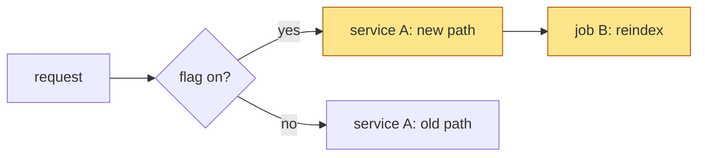

Every PR description has exactly these `##` sections, in this order: `What`, `Why`, `How`, `Verified`, `Details`.

Keep everything except `Details` high level. A reviewer must understand the whole PR from What/Why/How/Verified in under a minute.

## Sections

- **What**: 1-3 sentences on the change and its user-visible or reviewer-visible outcome. Then a ticket line: `Ticket: [KEY](url)`, or an explicit `No ticket`.
- **Why**: the motivation, the problem, what happens without the change. Link the originating discussion, PR review, Slack thread or incident when there is one (full URLs). Don't invent numbers or link what you cannot open.
- **How**: the approach in a few sentences, normally with a mermaid diagram (below).
- **Verified**: a short bullet list of what was verified and how: the exact command or run, with a link to the real CI run, PR check or observed output, and the numbers (e.g. test counts). Then an explicit `Not verified` list: what was reasoned but not observed, what could not be run (credentials, Linux vs macOS, prod behavior, load), and known caveats. Never claim a check passed that you did not observe; keep "observed" and "reasoned" separate. A visual or UI change includes screenshots of the changed parts and the states a reviewer needs.
- **Details**: everything else, in a collapsible toggle so the body stays short:

  ```
  <details>
  <summary>Details</summary>

  ...content...

  </details>
  ```

  The blank line after `<summary>` is required so markdown renders. Put here: file-by-file or job-by-job changes, event/decision matrices and tables, full verification output, edge cases, rejected alternatives, follow-ups, rollout/rollback notes, caveats and risks, lock/dependency changes. Mermaid diagrams may appear here too. Details must still be accurate and scannable: use headings and tables, not walls of text.

## Writing style: lists over prose

- Explain concepts, mechanisms and decisions as bulleted or numbered lists, not paragraphs. Use a numbered list for anything with an order (steps, a flow, an event sequence) and bullets for sets of facts, options or conditions.
- One idea per item, short enough to scan. Prose is for the one-to-three sentence summaries in `What` and `Why`.
- Prefer a table over a list when items share the same attributes (see `Details`).

## Link every code reference

Any mention of a file, directory, workflow, job, class, function, method, variable, config key, constant or specific statement is a link to that code on GitHub, on its first mention in each section (repeat the link where a reader would otherwise have to hunt for it).

- **Where it points:** the PR's version when the PR adds or changes that code; `main` when the PR does not touch it. Pick whichever is more relevant to what the sentence says.
- **Permalinks:** use a commit SHA, not a branch name, so the link and its line anchor don't drift: `https://github.com/<org>/<repo>/blob/<sha>/<path>#L10-L24`. For PR code use the PR head SHA (`gh pr view <n> --json headRefOid --jq .headRefOid`); for untouched code use the SHA of `main` at writing time (`gh api repos/<org>/<repo>/commits/main --jq .sha`). Check a link resolves (`gh api repos/<org>/<repo>/contents/<path>?ref=<sha>`).
- **Granularity:** a file for a file; the definition line (`#L<n>`) for a class, function, variable or key; a line range for a statement or block. The link text is the name in backticks: [`claim_warm_env`](https://github.com/org/repo/blob/abc123/src/app.py#L42).
- Re-point the links when the PR's head SHA changes materially (new commits that move or rewrite the referenced code).
- Don't link what you cannot open (private repos the reader cannot see, local-only paths).

## What GitHub renders: mermaid, not arbitrary HTML

GitHub sanitizes HTML in descriptions (checked with `gh api markdown`):

- Survives: `<details>`/`<summary>`, `<table>` (as plain tables), `<div align>`, `` and `<picture>`, `<b>`, `<sub>`, `<sup>`, `<kbd>`, `<ins>`, `<br>`.
- Stripped or escaped: `style=` attributes, `<style>`, `<script>`, `<iframe>`, inline `<svg>`, `<input>`, `<button>`, `<font>`, `javascript:` links.

So an HTML page cannot be rendered inline. Use mermaid for diagrams. Use HTML only for the Details toggle, alignment, and side-by-side images. For a visual that mermaid cannot express, attach a screenshot or an SVG/PNG as an image (`` or markdown), and link a hosted page if one exists.

## Mermaid diagrams: use them more often

Put a diagram in `How` whenever the change involves a flow, sequence, state, branching conditions, pipeline/job dependencies, a request path, a stack of PRs, architecture, or before/after behavior. When behavior changes, show before and after. Skip it only for trivial changes (typo, version bump, one-line fix) and say why in `How`.

- Pick the type that fits: `flowchart`, `sequenceDiagram`, `stateDiagram-v2`, `gitGraph`.
- Keep it small (roughly 4-12 nodes), label edges with the condition, and use real names from the code (job names, functions, files). No decorative diagrams.
- Use color (`classDef`) sparingly, only to mark what changed.
- Write valid GitHub-flavored mermaid in a fenced `mermaid` block. Avoid features GitHub does not support. Quote node labels containing parentheses, brackets, colons or slashes. No HTML in labels unless known to work.

## PR conventions

- Title starts with the Jira key: `KEY-123: <title>`.
- Open PRs as draft unless told otherwise.
- Link the Jira ticket in the body and add the PR to the Jira issue as a remote link (not only a comment). Keep status in step: draft or in progress = In Progress, open non-draft = In Review, merged = Done. With no ticket, say so explicitly.
- Refer to related PRs, such as others in a stack, by full markdown link plus a short description of what each does: `[#1692](https://github.com/org/repo/pull/1692) adds X`. Never a bare `#123`, never invented labels like "PR A".
- Public repos (for example dbt-labs/dbt-mcp) must not mention internal repos, internal Jira URLs or internal Slack.
- Documentation- or comment-only changes still get all five sections, but each may be one line.
- The last line of every description is `🤖 Generated with AI assistance`.

## Improving an existing description

1. Read the diff and the existing body: `gh pr view <n> --json title,body,files,commits` and `gh pr diff <n>`.
2. Sort the old body into high level vs detail. Move all detail into `Details`; add the How diagram. Turn prose that explains a concept into bulleted or numbered lists.
3. Keep every verified fact, caveat and link from the old body. Relocate information, never drop it. Re-check cheap claims against the repo instead of trusting old text.
4. Link every file, class, function, variable, key and statement mentioned (see "Link every code reference"): get the PR head SHA and the `main` SHA first, then link PR-changed code to the PR SHA and untouched code to `main`.
5. Write the new body to a temp file and run `gh pr edit <n> --body-file <file>`. Never pass large bodies inline.
6. Re-read the result: `gh pr view <n> --json body --jq .body`. Check the mermaid fences and the `<details>` structure are intact, and spot-check that code links resolve.
7. Validate mermaid before publishing if a validator is available: `npx -y -p @mermaid-js/mermaid-cli mmdc -i diagram.mmd -o /tmp/out.svg`, or parse with the `mermaid` package. If it cannot be installed, say so and keep the diagram simple.

## Template

````markdown
## What
<1-3 sentences: the change and its outcome.>

Ticket: [KEY-123](https://example.atlassian.net/browse/KEY-123)

## Why
<Problem or motivation, and what happens without it. Link the originating thread.>

## How
<Approach as a short list; link each code reference.>
1. <step> in [`name`](https://github.com/org/repo/blob/<sha>/path/file.py#L10)
2. <step>

```mermaid
<diagram>
```

## Verified
- <what was checked>: `<command>` or <link to CI run>, <numbers>.

Not verified:
- <reasoned but not observed, or could not run>

<details>
<summary>Details</summary>

### Changes
| File or job | Change | Why |
|---|---|---|

### Edge cases, alternatives, rollout, follow-ups
...

</details>

🤖 Generated with AI assistance
````

Example `How` diagram (generic):


