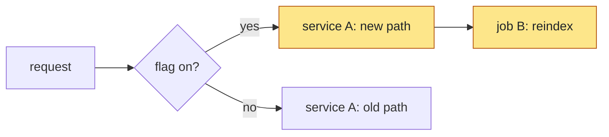

Every PR description is a header block, then these `##` sections in this order: `What`, `Before`, `After`, `Why`, `Decision Record`, `Verified`, `Details`.

Keep everything except `Details` high level. A reviewer must understand the whole PR from the header, What, Before/After, Why, Decision Record and Verified in under a minute.

## Header block

The first lines of the body, above `## What` and with no heading of their own. Ticket and stack information is not part of `What`: `What` describes the change, the header says where the PR sits. One line each, only the lines that apply:

- `Ticket: [KEY-123](url)`, or an explicit `No ticket`.
- For a PR that is stacked or has PRs stacked on it, `Stack:` followed by indented bullets, one open PR per bullet, bottom of the stack first, each PR indented one level under its parent. Mark this PR so it stands out when scanning down the list: make its whole bullet bold and end it with a pointer emoji and the words `this PR`, `**[#1759](url) <what it does>** 👈 **this PR**`. No other bullet is bold and no other bullet has the pointer. Include every ancestor and every descendant, so a reviewer sees the whole stack, and leave out PRs that have already merged: the lowest open PR is the top-level bullet. Two PRs stacked on the same parent are siblings at the same indent. Each bullet is `[#1692](url) <what it does>`. Omit the `Stack:` line for a PR that is not part of a stack.

  ```markdown
  Stack:
  - [#1709](url) One error vocabulary and retry policy for LLM calls
    - [#1729](url) Provider-specific behavior on the integration configs
      - [#1728](url) `LlmModel` as a frozen dataclass
        - **[#1759](url) Provider error vocabularies on the configs** 👈 **this PR**
  ```
- `Design: [title](url)` for the design doc, Notion page or Slack thread the work follows.

## Sections

- **What**: 1-3 sentences on the change and its user-visible or reviewer-visible outcome. When the approach is not obvious from `Before`/`After`, follow with a short numbered list of how it works, one idea per step, linking each code reference. The detailed mechanics (every file, every call site) go in `Details`. No ticket or stack lines here; they are in the header. There is no separate `How` section.
- **Before** and **After**: short excerpts of the relevant parts of the change, side by side in meaning, so a reviewer sees the shape of the change without reading the diff. See "Before and After" below.
- **Why**: the motivation, the problem, what happens without the change. Link the originating discussion, PR review, Slack thread or incident when there is one (full URLs). Don't invent numbers or link what you cannot open.
- **Decision Record**: the decisions the PR was built around and how each was carried out, written the way decisions are discussed in review. A decision comes from the author (me), a reviewer or another person: a request in chat, a review comment, a Slack thread, a ticket comment, a design doc. One entry per decision, in the order they were made, in exactly this shape: a bold lead a reviewer can read on its own, with the supporting bullets folded into a `Details` toggle.

  ```markdown
  - **Devon** (chat): **Keep the retry policy unchanged.** The new classifier feeds the existing schedule in [`retry_policy.py`](https://github.com/org/repo/blob/<sha>/src/app/retry_policy.py#L108) instead of replacing it, so retry timing stays the same as today.
    <details>
    <summary>Details</summary>

    - Context: the new classifier could have replaced the schedule, and Devon wanted no behavior change in retries ("keep retries as they are").
    - Benefits: retry timing is identical to today.
    - Costs: the classifier keeps a mapping layer it could otherwise drop.
    - Risks: the mapping can drift from the schedule table; a test pins it.
    - Alternatives: derive the schedule from the new classes (rejected: changes retry timing).

    </details>
  - **wiggzz** ([review comment](https://github.com/org/repo/pull/123#discussion_r1)): **Drop the fallback path.** <what was removed and what replaces it, with a code link>
    <details>
    <summary>Details</summary>

    - Context: ...
    - Benefits: ...
    - Costs: ...
    - Risks: ...
    - Alternatives: ...

    </details>
  ```

  - **The lead line** is `**<Who>** (<where>): **<Decision title>.** <one or two sentences>`. Name who made the decision and where (link the thread, comment or doc when it can be opened; "chat" when it was said to the agent in a session). The bold title is a few words naming the decision, not the instruction's full text. The sentences after it say, in plain words, what was decided, what it was chosen over when there was a real alternative, and how the PR carries it out, linking the code or commit. A reviewer who reads only the lead lines should be able to follow the decisions without opening a toggle.
  - **The `Details` toggle** holds the five sub-bullets, always in this order: `Context` (the situation and why it came up, with the person's short quote when they gave a reason), `Benefits`, `Costs`, `Risks`, `Alternatives` (what else was considered and why it was not chosen). Keep each to one or two lines; put long reasoning in the PR's own `Details`. Write `None` rather than dropping a sub-bullet. The toggle is indented to the list item, with a blank line after `<summary>` and before `</details>`, so it renders inside the list.
  - Include decisions that shaped scope, design or behavior, and any that were deliberately **not** followed (record the instruction as the title, the reason in the lead sentences, and the person's quote in `Context`). Leave out routine ones (fix a typo, rename a variable).
  - It is not a changelog: do not list changes nobody asked for; those belong in `What` and `Details`.
  - Only human decisions go in the record. A choice the agent made itself (a scope limit, default, flag, rollout gate, list of statuses or types, naming, or where code lives) is not a decision entry, even labelled as the agent's: describe it in `What` or `Details` as how the change works, without attribution.
  - Leave the section out when no person gave an instruction or made a choice beyond the ticket, as for a trivial change or a PR the agent designed alone. Do not write a section that only says there were none.

  Attribution is the part reviewers trust, so it is strict. Never put a decision, a reason or a quote in a person's name unless they said it:
  - **Attribute only what the person said.** Name a person as the source of a decision only when you can point to their words: a quote or close paraphrase from their message, with a link to the review comment, thread or doc, or, for a chat decision, a message from the user in the session. If you cannot point to their words, it is not their decision.
  - **Your own choices are not in the record.** Any scope limit, default, flag, rollout gate, list of statuses or types, naming or other choice the person did not state, including one you made while following a ticket or a brief, stays out of the `Decision Record`. Never record it under a person's name, and never as "ship it" because the person approved something nearby.
  - **A pick covers only that pick.** When you offered options and the person chose one, the decision is theirs, described in plain words as what they chose over what ("chose to keep the Helm value rather than make the behavior always on"), and it covers only that choice. Silence, "looks good", or an answer to a different question confirms nothing else.
  - **Confirmation adds the entry.** When the author later states or confirms a choice you made, add it as their decision with their words in `Context`, in plain words ("chose to keep it rather than ..."). Until then it is not in the record.
  - **Write for a reader who was not in the conversation.** Never use chat shorthand in the description: decision or option labels (`D1`, `O2`, "option 1", "the first option"), message or question numbers, "as discussed", "per the earlier list", or abbreviations only the author knows. Describe each choice in plain words, naming what was chosen and what it was chosen over. If a person's reply was only a label, do not quote it; describe the choice in plain words and attribute it to them.
  - **Quote, do not reword.** When the person gave a reason, put a short verbatim quote in `Context`. Never tidy or invent a quote, and never supply a rationale and attribute it to them.
  - **A brief is not a source.** When another agent, a summary or a delegation brief supplies the decisions, check each attribution against the original conversation, review comment or thread before publishing. A brief that says "put these in the record" does not make them the author's; decisions in it that the author never stated are left out.
  - **When you delegate the description,** write each human decision into the brief with who made it and their words, leave your own choices out of the decisions, and tell the agent to attribute exactly as given.
- **Verified**: the testing done **in addition to** the normal tests and checks, a `Coverage` list of what is and is not tested, and a `Not verified` list. Do not list or count what CI already runs (unit tests, lint, type checks, build, pre-commit): the PR's checks show it. Include what CI cannot show:
  - a manual or end-to-end run, with the exact command and a link to the output or run;
  - a run on real data or in the real tool (a render, a deployed environment, a devspace);
  - a before/after comparison harness, a benchmark, a load or performance check, screenshots for a visual change.

  For matrix testing (many inputs, configs, providers, models or event types), give one or two sentences: which dimensions were covered (for example "every provider x every reasoning effort") and any surprise or difference found. Put the full tables, counts and per-case results in `Details`.

  Then a `Coverage` list describing what the PR's tests do and do not exercise, so a reviewer sees the gaps without reading the test files. Describe behavior and paths, not counts, and name the kind of test each is (unit test with fakes, integration test against a real service or environment, a comparison harness, none):
  - `Tested`: each behavior or path that has an automated test, and by what kind. Say when a test uses a fake where the real dependency matters (for example "the provider call is faked").
  - `Not tested`: each behavior or path with no automated test of any kind, including paths covered only by a fake, and why when it is known (no credentials in CI, no environment, not worth a test). Do not repeat CI totals.

  `Coverage` is about the tests that exist in the repo after the PR; `Not verified` is about what nobody observed. A path can be in both (no test and never run) or only in `Coverage` (tested with fakes, and the real run was done once by hand under Verified).

  Then an explicit `Not verified` list: what was reasoned but not observed, what could not be run (credentials, Linux vs macOS, prod behavior, load), and known caveats. Never claim a check passed that you did not observe; keep "observed" and "reasoned" separate. If the only verification is what CI runs, write "Covered by CI." and keep the `Not verified` list. A visual or UI change includes screenshots of the changed parts and the states a reviewer needs.
- **Details**: everything else, in a collapsible toggle so the body stays short:

  ```
  <details>
  <summary>Details</summary>

  ...content...

  </details>
  ```

  The blank line after `<summary>` is required so markdown renders. Put here: file-by-file or job-by-job changes, event/decision matrices and tables, full verification output and matrix results, edge cases, rejected alternatives, follow-ups, rollout/rollback notes, caveats and risks, lock/dependency changes. Mermaid diagrams may appear here too. Details must still be accurate and scannable: use headings and tables, not walls of text.

## Before and After

Show the relevant parts of the change, not all of it: enough that a reviewer sees what moved without reading the diff.

- **Form:** a short code excerpt for a code change (the type, the signature, the config, the call), a few lines of output or a screenshot for behavior, or a small table or list for a rule or a set of values. Put each in its own section, `Before` then `After`, and keep them parallel so they can be compared line by line.
- **Size:** about 5-20 lines each. Keep the lines that carry the change, elide the rest with `...` or a short comment such as `# 14 more fields`, and use the real names from the code. If an excerpt needs more than that, the rest belongs in `Details`.
- **Not a diff:** do not paste `git diff` output or whole files. Do not list every file that changed; that is the file-by-file table in `Details`.
- **Skip** `Before`/`After` when there is nothing to contrast (a new file or feature with no prior behavior: keep `After` only; a typo, version bump or one-line fix: neither, and `What` says so). A pure move can show the old and new location in two lines.
- Link the code mentioned in each excerpt's lead-in sentence (see "Link every code reference"); the excerpt itself stays plain.

## Writing style: lists over prose

- Explain concepts, mechanisms and decisions as bulleted or numbered lists, not paragraphs. Use a numbered list for anything with an order (steps, a flow, an event sequence) and bullets for sets of facts, options or conditions.
- One idea per item, short enough to scan. Prose is for the one-to-three sentence summaries in `What` and `Why`.
- Prefer a table over a list when items share the same attributes (see `Details`).

## Link every code reference

Any mention of a file, directory, workflow, job, class, function, method, variable, config key, constant or specific statement is a link to that code on GitHub, on its first mention in each section (repeat the link where a reader would otherwise have to hunt for it).

- **Where it points:** the PR's version when the PR adds or changes that code; `main` when the PR does not touch it. Pick whichever is more relevant to what the sentence says.
- **Permalinks:** use a commit SHA, not a branch name, so the link and its line anchor don't drift: `https://github.com/<org>/<repo>/blob/<sha>/<path>#L10-L24`. For PR code use the PR head SHA (`gh pr view <n> --json headRefOid --jq .headRefOid`); for untouched code use the SHA of `main` at writing time (`gh api repos/<org>/<repo>/commits/main --jq .sha`). Check a link resolves (`gh api repos/<org>/<repo>/contents/<path>?ref=<sha>`).
- **Granularity:** a file for a file; the definition line (`#L<n>`) for a class, function, variable or key; a line range for a statement or block. The link text is the name in backticks: [`claim_warm_env`](https://github.com/org/repo/blob/abc123/src/app.py#L42).
- Re-point the links when the PR's head SHA changes materially (new commits that move or rewrite the referenced code).
- Don't link what you cannot open (private repos the reader cannot see, local-only paths).

## What GitHub renders: mermaid, not arbitrary HTML

GitHub sanitizes HTML in descriptions (checked with `gh api markdown`):

- Survives: `<details>`/`<summary>`, `<table>` (as plain tables), `<div align>`, `` and `<picture>`, `<b>`, `<sub>`, `<sup>`, `<kbd>`, `<ins>`, `<br>`.
- Stripped or escaped: `style=` attributes, `<style>`, `<script>`, `<iframe>`, inline `<svg>`, `<input>`, `<button>`, `<font>`, `javascript:` links.

So an HTML page cannot be rendered inline. Use mermaid for diagrams. Use HTML only for the Details toggle, alignment, and side-by-side images. For a visual that mermaid cannot express, attach a screenshot or an SVG/PNG as an image (`` or markdown), and link a hosted page if one exists.

## Mermaid diagrams: only when they add something

Do not add a diagram by default. Most PRs do not need one, and a diagram that restates the numbered steps in `What` in a different shape is noise. The test: if a reviewer would lose nothing by deleting the diagram, delete it.

- **Worth it:** structure a list cannot show well: branching with conditions, several actors exchanging messages in order, a state machine, dependencies where more than one thing feeds another (fan-in or fan-out), or a topology (services, jobs, a stack of PRs) where the connections are the point.
- **Not worth it:** a linear chain (`a` then `b` then `c`) that matches the numbered steps in `What`; a refactor or a move of code between modules or classes; a change inside one component; a rename; a diagram whose boxes are just the names already in the list; anything that mostly exists to make the description look complete. Use `Before`/`After` excerpts for these, not a diagram.
- When behavior changes, `Before` and `After` show it; a diagram is only for when the contrast is structural and an excerpt cannot carry it.
- **Always required: a class diagram when the PR changes a class hierarchy.** If the PR adds, removes, renames or reparents classes in an inheritance or interface relationship (a new base class, one class split into several, a mixin or flag moved into the hierarchy), include a mermaid `classDiagram` of the hierarchy as it is after the change, with the base classes, the abstract members the PR adds or changes, and the concrete subclasses. When the hierarchy was reshaped (not just extended), add the `Before` diagram too, side by side in meaning with `After`. Mark added, removed and moved classes with `classDef` colors as described below. Put it in `After` (and `Before`); a class diagram does not count against the one-diagram limit below. Unrelated classes and plain data classes do not need one.
- One other diagram at most in the visible body, in `What` after the steps; more go in `Details`. When you skip it, say nothing; do not explain the absence.

When one is worth it:

- Pick the type that fits: `flowchart`, `sequenceDiagram`, `stateDiagram-v2`, `gitGraph`, and `classDiagram` for a class hierarchy (`Base <|-- Child` for inheritance, abstract members marked with `*` after the name, for example `+error_kind()* str`, `<<abstract>>` on abstract classes).
- Keep it small (roughly 4-12 nodes), label edges with the condition, and use real names from the code (job names, functions, files). No decorative diagrams.
- Use color (`classDef`) sparingly, only to mark what changed. Always set `color` (the text) together with `fill`: GitHub's dark theme draws unstyled text in near-white, so a light `fill` without a `color` gives white text on yellow that nobody can read. Use a light fill with dark text, which is readable in both the light and dark themes: changed `fill:#fde68a,stroke:#b45309,color:#1f2328`, added `fill:#bbf7d0,stroke:#15803d,color:#1f2328`, removed `fill:#fecaca,stroke:#b91c1c,color:#1f2328`. Leave unchanged nodes unstyled, so they follow the theme.
- Write valid GitHub-flavored mermaid in a fenced `mermaid` block. Avoid features GitHub does not support. Quote node labels containing parentheses, brackets, colons or slashes. No HTML in labels unless known to work.

## PR conventions

- Title starts with the Jira key: `KEY-123: <title>`.
- Open PRs as draft unless told otherwise.
- Link the Jira ticket in the body. Do not add the PR to the Jira issue as a remote link. Keep status in step: draft or in progress = In Progress, open non-draft = In Review, merged = Done. With no ticket, say so explicitly.
- Refer to related PRs, such as others in a stack, by full markdown link plus a short description of what each does: `[#1692](https://github.com/org/repo/pull/1692) adds X`. Never a bare `#123`, never invented labels like "PR A".
- Never mention `toolbelt` (Devon's personal tool) in a description or in the code, comments and docs of the PR. Describe the general mechanism instead, such as a stack sync, a merge of `main`, or GitHub's "Update branch".
- Public repos (for example dbt-labs/dbt-mcp) must not mention internal repos, internal Jira URLs or internal Slack.
- Documentation- or comment-only changes still get the header, `What`, `Why` and `Verified`, but each may be one line; skip `Before`, `After` and `Decision Record`.
- Never attribute a decision, approval, reason or quote to a person who did not say it (see `Decision Record`). Your own choices are not recorded as decisions.
- The description is read by people who were not in the conversation: no chat shorthand such as `D1`, `O1` or "option 2", and no references to earlier messages. Say the choice in plain words.
- The last line of every description is `🤖 Generated with AI assistance`.

## Improving an existing description

1. Read the diff and the existing body: `gh pr view <n> --json title,body,files,commits` and `gh pr diff <n>`.
2. Sort the old body into high level vs detail. Move all detail into `Details`. Move the ticket, stack and design lines into the header block. Add `Before` and `After` excerpts of the relevant parts of the change. Fold a `How` section into `What` (a short list) and `Details` (the mechanics). Add a `Decision Record` from the decisions and instructions in the old body, the PR's review threads and the conversation that produced it. Cut `Verified` down to testing beyond CI. Add a diagram only if it passes the test in "Mermaid diagrams"; remove one that does not. Turn prose that explains a concept into bulleted or numbered lists.
3. Check every attribution in the `Decision Record` against the source (see "Attribute only what the person said"): for each entry naming a person, find the message, comment or thread with their words and put a quote in `Context`; recheck whether the conversation later confirmed or changed the decision; remove any entry without their words from the record (describe it in `What` or `Details` if it still matters). Replace any chat shorthand (`D1`, `O1`, "option 2") with plain words. Do this even when the entries came from an old body, a summary or another agent's brief.
4. Keep every verified fact, caveat and link from the old body. Relocate information, never drop it. Re-check cheap claims against the repo instead of trusting old text.
5. Link every file, class, function, variable, key and statement mentioned (see "Link every code reference"): get the PR head SHA and the `main` SHA first, then link PR-changed code to the PR SHA and untouched code to `main`.
6. Write the new body to a temp file and run `gh pr edit <n> --body-file <file>`. Never pass large bodies inline.
7. Re-read the result: `gh pr view <n> --json body --jq .body`. Check any mermaid fences and the `<details>` structure are intact, and spot-check that code links resolve.
8. If the body has a mermaid diagram, validate it before publishing if a validator is available: `npx -y -p @mermaid-js/mermaid-cli mmdc -i diagram.mmd -o /tmp/out.svg`, or parse with the `mermaid` package. If it cannot be installed, say so and keep the diagram simple.

## Template

````markdown
Ticket: [KEY-123](https://example.atlassian.net/browse/KEY-123)
Stack:
- [#1692](https://github.com/org/repo/pull/1692) <what it does>
  - **[#1693](https://github.com/org/repo/pull/1693) <what it does>** 👈 **this PR**
    - [#1694](https://github.com/org/repo/pull/1694) <what it does>
Design: [title](https://example.com/design)

## What
<1-3 sentences: the change and its outcome.>
1. <how it works, only when Before/After do not make it obvious; link each code reference>
2. <step>

## Before
```python
# the relevant lines of the old shape, 5-20 lines, elided with ...
```

## After
```python
# the same parts in the new shape
```

## Why
<Problem or motivation, and what happens without it. Link the originating thread.>

## Decision Record
- **<Who>** (<where, linked>): **<Decision title>.** <What was decided, what it was chosen over, and how the PR carries it out, with a code or commit link.>
  <details>
  <summary>Details</summary>

  - Context: <the situation and why it came up; the person's short quote when they gave a reason>
  - Benefits: ...
  - Costs: ...
  - Risks: ...
  - Alternatives: ...

  </details>
- **<Who>** (<where>): **<An instruction deliberately not followed.>** <What was asked and why the PR does not do it.>
  <details>
  <summary>Details</summary>

  - Context: ...
  - Benefits: ...
  - Costs: ...
  - Risks: ...
  - Alternatives: ...

  </details>

## Verified
- <testing beyond CI: the command or run and a link to its output>.
- <matrix testing: the dimensions covered and any surprise; full results in Details>.

Coverage:
- Tested: <behavior or path> by <unit test with fakes | integration test against a real service | harness>.
- Not tested: <behavior or path with no automated test, and why>.

Not verified:
- <reasoned but not observed, or could not run>

<details>
<summary>Details</summary>

### Changes
| File or job | Change | Why |
|---|---|---|

### Mechanics, matrix results, edge cases, alternatives, rollout, follow-ups
...

</details>

🤖 Generated with AI assistance
````

Example diagram for when one is warranted (branching across jobs, generic):


